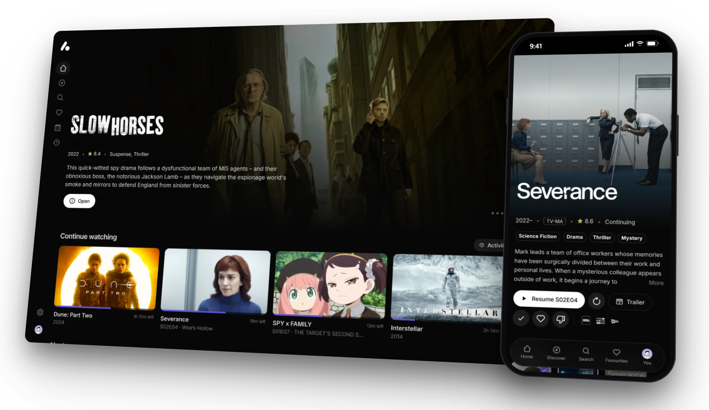
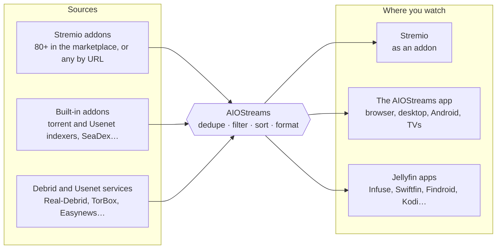
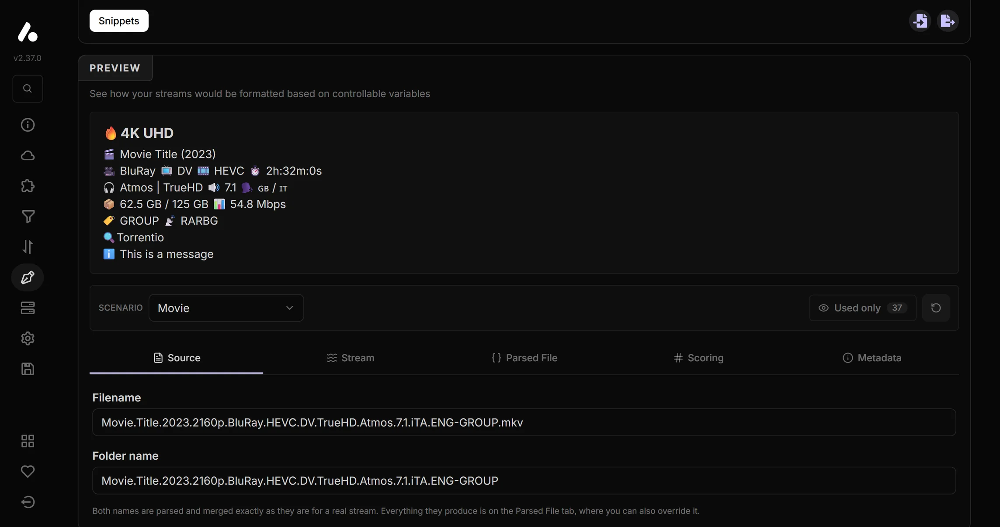
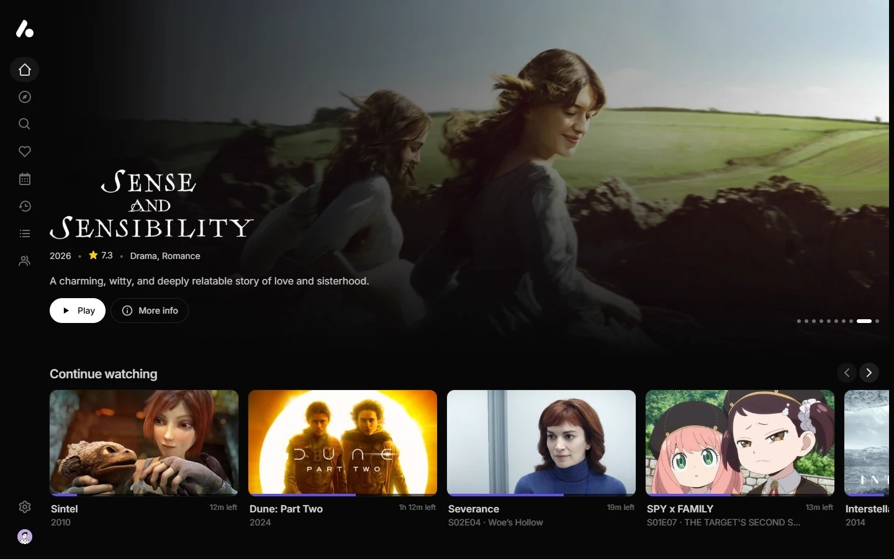
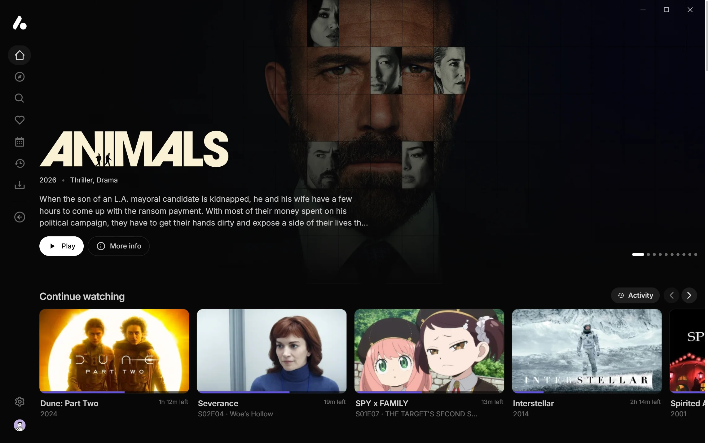
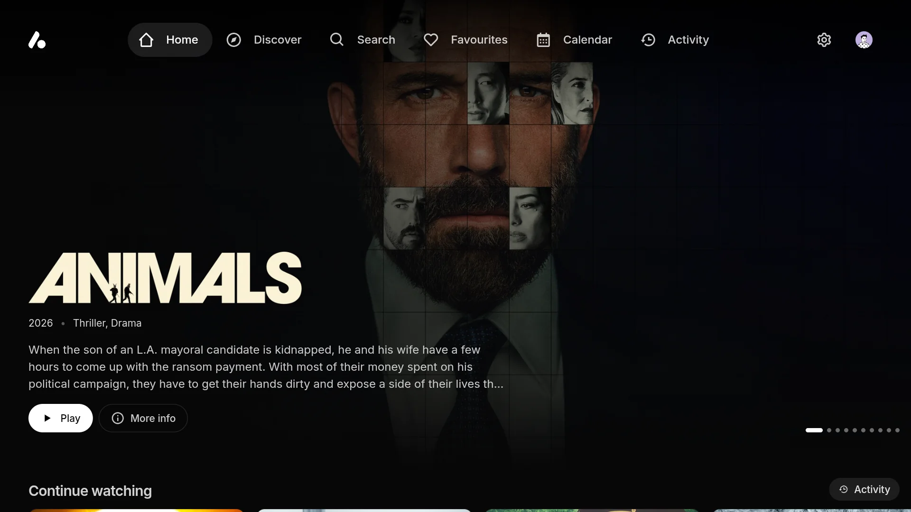
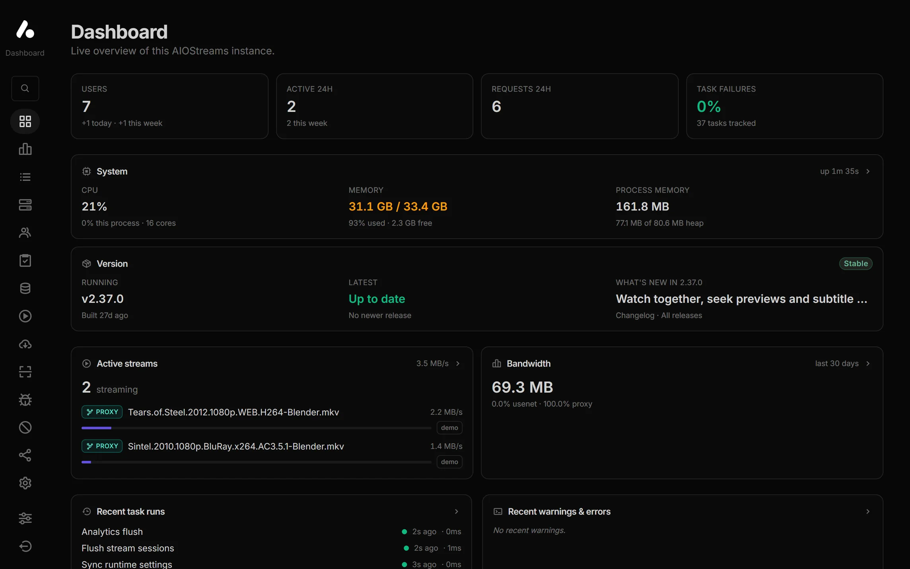

<p align="center">
  <picture>
    <source media="(prefers-color-scheme: dark)" srcset="https://cdn.jsdelivr.net/gh/selfhst/icons/png/aiostreams-light.png">
    
  </picture>
</p>

<h1 align="center">AIOStreams</h1>

<p align="center">
  <strong>One addon for all your sources, and the apps to watch them in.</strong>
</p>

<p align="center">
  AIOStreams brings your Stremio addons, debrid services and Usenet together into one list, filtered, sorted
  and formatted your way, and plays it in Stremio or in its own apps for every screen.
</p>

<p align="center">
  <a href="https://github.com/Viren070/AIOStreams/releases/latest"></a>
  <a href="https://hub.docker.com/r/viren070/aiostreams"></a>
  <a href="https://github.com/Viren070/AIOStreams/stargazers"></a>
  <a href="https://discord.viren070.me"></a>
  <a href="https://github.com/sponsors/Viren070"></a>
</p>

<p align="center">
  <a href="https://docs.aiostreams.viren070.me"><strong>Docs</strong></a> ·
  <a href="https://docs.aiostreams.viren070.me/getting-started/public-instances">Public instances</a> ·
  <a href="https://docs.aiostreams.viren070.me/apps">Apps</a> ·
  <a href="https://docs.aiostreams.viren070.me/changelog">Changelog</a> ·
  <a href="https://discord.viren070.me">Discord</a>
</p>

<p align="center">
  
</p>

---

## What it does

Instead of juggling a dozen addons, each with its own settings and its own way of listing results, you
configure AIOStreams once. It asks every source you've added, removes the duplicates, filters, sorts and
names what comes back by your rules, and hands you one clean list, wherever you watch.



Everything here works on a [public instance](https://docs.aiostreams.viren070.me/getting-started/public-instances).
Host your own and you also get [a Usenet engine and more](#-on-your-own-instance).

---

## 🎛️ Your rules

Because every source goes through AIOStreams, you set your rules once and they apply to every addon.

- **Filters** by resolution, quality, encode, HDR and Dolby Vision, audio, language, size, bitrate, seeders,
  age, cache status, keywords and regular expressions, with matching that checks titles, years and episodes so
  you only see the right file.
- **Sorting** by any stack of criteria, separately for movies, series and anime and for cached and uncached
  results, with ranked preferences and [scores](https://docs.aiostreams.viren070.me/guides/scored-sorting).
- **Deduplication** by file name, info hash, or a fingerprint of the file's details.
- **[Stream expressions](https://docs.aiostreams.viren070.me/reference/stream-expressions)** for rules that depend
  on the whole list, such as dropping 720p only when there's enough 1080p.
- **A [formatter](https://docs.aiostreams.viren070.me/reference/custom-formatter)** that names each stream the way
  you want, with a live preview and ready-made formats to start from.
- **Catalogs** renamed, reordered, merged, shuffled or hidden, with better posters from services like RPDB.
- **[Groups](https://docs.aiostreams.viren070.me/guides/groups)** that ask backup addons only when the main ones
  come up short, and **[variants](https://docs.aiostreams.viren070.me/reference/config-expressions)** that serve
  several differently tuned addons from one configuration.
- **[Templates](https://docs.aiostreams.viren070.me/reference/templates)** to start from a complete setup someone
  shared, and **[profiles](https://docs.aiostreams.viren070.me/guides/config-profiles)** to reopen yours by signing in.

<p align="center">
  
</p>

---

## 🔌 Sources

- **Addon marketplace**: 80+ community addons (Torrentio, Comet, MediaFusion and many more) to enable in a
  click, or add any Stremio addon by URL. Streams, catalogs, metadata and subtitles are all supported.
- **Built-in addons** that run inside AIOStreams: torrent and Usenet indexers, Prowlarr, Jackett, NZBHydra2,
  Newznab and Torznab, SeaDex for anime, Google Drive, and your debrid or Usenet library.
- **Services** entered once and applied to every addon that can use them: Real-Debrid, AllDebrid, TorBox,
  Premiumize, Debrid-Link, put.io, Offcloud, PikPak, EasyDebrid and more for debrid; Easynews, NzbDAV, AltMount,
  Stremio NNTP and StremThru Newz for Usenet.

<details>
<summary><strong>The built-in addons</strong></summary>

| Addon | What it searches |
| --- | --- |
| **Knaben** | A meta-search across The Pirate Bay, 1337x, Nyaa and more |
| **The Pirate Bay** | The Pirate Bay, by title and IMDb ID |
| **TheRARBG** | TheRARBG, by title and IMDb ID |
| **Torrent Galaxy** | Torrent Galaxy |
| **EZTV** | TV shows on EZTV |
| **Zilean** | A Zilean DMM hashlist instance |
| **Bitmagnet** | Your self-hosted Bitmagnet DHT crawler |
| **SeaDex** | The community's best releases for anime |
| **AnimeTosho** | Most Nyaa and TokyoTosho anime releases |
| **NekoBT** | Anime releases on nekoBT |
| **Tsukihime** | Anime releases, matched by MAL and AniDB ID |
| **Prowlarr**, **Jackett** | Your indexer manager |
| **NZBHydra2** | Your Usenet indexers, through NZBHydra2 |
| **Newznab**, **Torznab** | Any Newznab (Usenet) or Torznab (torrent) indexer |
| **Easynews Search** | Easynews' Usenet index |
| **Stremio GDrive** | Your Google Drive |
| **Library** | What's already in your debrid or Usenet library |

Built-in addons that search torrents need a debrid service. Every built-in addon supports anime and Kitsu
and MAL catalogs.

</details>

---

## 📺 Watch anywhere

### In Stremio

Install AIOStreams as one addon in place of the rest, in Stremio or any app that supports Stremio addons.
Link your Stremio account and changes you save reinstall themselves.

### In the AIOStreams app

Your catalogs become libraries and your streams become versions of a title, sorted and named by your rules,
in an app of AIOStreams' own. There's nothing extra to host: every configuration is also a media server, so
the app signs in to it, and so does any Jellyfin app.

<p align="center">
  
</p>

| Where | App | Plays with |
| --- | --- | --- |
| Any browser | Nothing to install; add it to a phone's home screen to open it like an app | The browser |
| Windows, macOS, Linux | [Desktop app](https://docs.aiostreams.viren070.me/apps/desktop) | mpv: nearly any format, HDR, surround passthrough, styled subtitles |
| Android phones and tablets | [Android app](https://docs.aiostreams.viren070.me/apps/android) | ExoPlayer or mpv: HDR and Dolby Vision, passthrough, styled subtitles |
| Android TV, Google TV, Fire TV | [Android app](https://docs.aiostreams.viren070.me/apps/android#on-a-tv), with a layout made for the remote | ExoPlayer or mpv |
| LG and Samsung TVs (beta) | [TV apps](https://docs.aiostreams.viren070.me/apps/smart-tv), installed from a file | The TV's own player |
| iPhone, iPad, Apple TV, Kodi… | A browser, or any [Jellyfin app](https://docs.aiostreams.viren070.me/apps/jellyfin) such as Infuse or Swiftfin | The app's own player |

The apps play streams with a link, such as debrid and Usenet ones; P2P torrents stay in Stremio.

- **Browse** home rows for Continue Watching, Next Up and each catalog, Discover, search, collections,
  favourites, a calendar of airing episodes, trailers, and a page for every title and person.
- **Versions** are your streams. Search them, save quick filters, label them with badges, switch mid-play, or
  open one in VLC, Infuse or another player.
- **Play** with your audio and subtitle languages, styled subtitles, subtitle sync (by ear or by picking the
  spoken line), seek previews, skipped intros and credits, and the next episode on its own.
- **Households** get a user each, with their own Continue Watching and an optional PIN; TVs sign in with a
  Quick Connect code.
- **Watch together** in sync with friends, on your server or across servers, with chat and reactions.
- **Play on another device** turns the app into a remote for a TV or computer running it.
- **Playlists**, **downloads** for offline viewing on desktop and Android, and **tracker sync** with addons
  that support [Watch State](https://docs.aiostreams.viren070.me/reference/addon-protocol/watch-state).
- **Themes**, your own colours and [custom CSS](https://docs.aiostreams.viren070.me/reference/web-app-css), and
  the apps in your language, translated on [Weblate](https://hosted.weblate.org/engage/aiostreams/).

<p align="center">
  
  
</p>

### Elsewhere

From the same page you can also add AIOStreams to [Seanime](https://docs.aiostreams.viren070.me/guides/seanime),
Chillio and Aniyomi, or query it through the [search API](https://docs.aiostreams.viren070.me/apis/search).

---

## 🏠 On your own instance

[Hosting AIOStreams yourself](https://docs.aiostreams.viren070.me/getting-started/deployment) (or on a private
ElfHosted instance) adds what a public instance can't offer.

- **A built-in Usenet engine.** Give it your NNTP provider and it streams releases straight from Usenet,
  archives included, with no NzbDAV, AltMount or SABnzbd in between. In the public
  [Usenet streaming benchmark](https://github.com/Viren070/nzb-streaming-benchmarks), which runs nine
  applications over the same releases, it is first to the first byte and first to finish a seek.
  [Usenet guide](https://docs.aiostreams.viren070.me/guides/usenet).
- **[Sonarr and Radarr](https://docs.aiostreams.viren070.me/guides/sonarr-radarr)** can use the engine as their
  SABnzbd download client: they grab as usual, and Plex, Jellyfin or Emby stream the release from Usenet on
  demand, a library that takes no disk space. AIOStreams can also be their Newznab and Torznab indexer.
- **A [release blocklist](https://docs.aiostreams.viren070.me/guides/release-blocklist)** that remembers dead and
  fake releases, drops them before they're tried, and can be shared between instances.
- **A dashboard** for the instance: live streams and bandwidth, analytics, logs, users, the Usenet library and
  providers, cache, tasks, crash reports from the apps, and every runtime setting.
- **Accounts** from `AIOSTREAMS_AUTH` or any OpenID Connect provider through [SSO](https://docs.aiostreams.viren070.me/guides/sso),
  with per-user permissions, on SQLite or PostgreSQL, with Redis for several replicas.
- **Proxies**: the built-in proxy, MediaFlow Proxy or StremThru, for services that limit how many IPs can stream.

<p align="center">
  
</p>

---

## 🚀 Getting started

1. **Pick an instance**
   - A [public instance](https://docs.aiostreams.viren070.me/getting-started/public-instances): free, nothing to set up.
   - [Your own](https://docs.aiostreams.viren070.me/getting-started/deployment):

     ```bash
     curl -O https://raw.githubusercontent.com/Viren070/AIOStreams/main/compose.yaml
     curl -o .env https://raw.githubusercontent.com/Viren070/AIOStreams/main/.env.sample
     # set SECRET_KEY in .env (a 64-character hex string), then:
     docker compose up -d
     ```

   - Managed hosting from **[ElfHosted](https://store.elfhosted.com/product/aiostreams/?utm_source=github&utm_medium=readme&utm_campaign=aiostreams-readme)**, a project sponsor.
2. **Configure it** at `/stremio/configure`: add your services, pick addons and set your rules, or import a
   [template](https://docs.aiostreams.viren070.me/configuration/setup) to start from a complete setup.
3. **Save** with a password.
4. **Install or open it** from **Save & Install**: in Stremio, in the AIOStreams app, in a Jellyfin app, or in
   any of the other apps listed there.

The [documentation](https://docs.aiostreams.viren070.me) covers every option, environment variable and guide.

---

## ❤️ Support the project

AIOStreams is built and maintained for free. If it's useful to you:

- ⭐ Star the repository, and the addon in the [Stremio Community Catalog](https://stremio-addons.net/addons/aiostreams).
- 🌍 [Translate the apps](https://hosted.weblate.org/engage/aiostreams/) into your language.
- 🤝 Report bugs, suggest features or open a pull request.
- ☕ Donate on [Ko-fi](https://ko-fi.com/viren070) or [GitHub Sponsors](https://github.com/sponsors/Viren070).

<h2 align="center">⭐ Star history</h2>

<p align="center">
  <a href="https://star-history.com/#Viren070/AIOStreams&Date">
    <picture>
      <source media="(prefers-color-scheme: dark)" srcset="https://api.star-history.com/svg?repos=Viren070/AIOStreams&type=Date&theme=dark">
      
    </picture>
  </a>
</p>

---

## ⚠️ Disclaimer

AIOStreams does not host, store or distribute any content. It connects to the sources you configure (addons,
debrid services and Usenet providers) and plays what they return. The developer does not endorse or promote
access to copyrighted content. You are responsible for complying with the laws that apply to you and with the
terms of every service you use with AIOStreams.

## 🙏 Credits

AIOStreams builds on the work of many others, especially the developers of the addons it integrates.

- [mpv](https://mpv.io), [FFmpeg](https://ffmpeg.org), [libass](https://github.com/libass/libass) and
  [Media3 ExoPlayer](https://github.com/androidx/media), which the apps play video with.
- [Jellyfin](https://jellyfin.org), whose API the media server speaks.
- [mhdzumair/mediaflow-proxy](https://github.com/mhdzumair/mediaflow-proxy) and [MunifTanjim/stremthru](https://github.com/MunifTanjim/stremthru).
- UI components and issue templates adapted with permission from [5rahim/seanime](https://github.com/5rahim/seanime).
- [NzbDAV](https://github.com/nzbdav-dev/nzbdav) and [AltMount](https://github.com/javi11/altmount) support, inspired by
  [Sanket9225/UsenetStreamer](https://github.com/Sanket9225/UsenetStreamer/).
- [sleeyax/stremio-easynews-addon](https://github.com/sleeyax/stremio-easynews-addon), the project's initial structure.
- The formatter, inspired by and adapted from [diced/zipline](https://github.com/diced/zipline).
- The Stream Expression Language, powered by [silentmatt/expr-eval](https://github.com/silentmatt/expr-eval).
